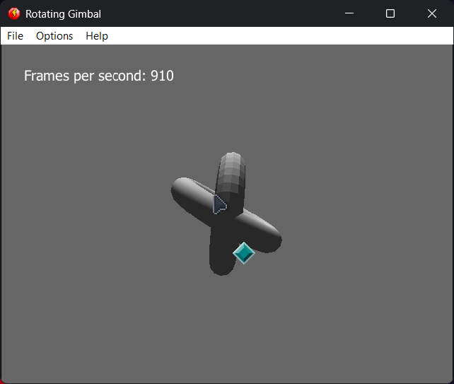
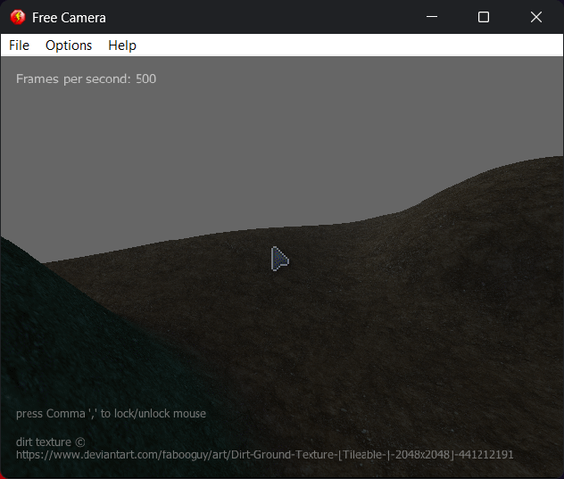

#  3D Mesh Ex object

**3D Mesh Ex** (Windows) is intended to be the unofficial successor to the original 3D Mesh object (© Erik G.) for Clickteam Fusion 2.5. It supports modern formats (.obj & .fbx), skeletal animation (with .fbx), per-pixel directional lighting, full camera controls, per-subset mesh transform manipulation, and more.

Unlike most (if not all at the time of writing) 3D extensions for Fusion, this extension does not bring in it's own renderer such as a new OpenGL context or another rendering engine layered on top of Fusion. Instead, **the extension uses Fusion's HWA renderer directly**, utilizing the Direct3D 9/11 interfaces directly exposed by `cSurface::GetDriverInfo`. This approach enables the extension to keep the framerate high as no OpenGL render target or similar needs to be CPU-copied onto Fusion's main surface to actually bring it on-screen (slow), or rendering to another Win32 child window to maintain performance (meaning all objects, such as Actives, can no longer be displayed on top of the 3D mesh surface). The rendering approach of **3D Mesh Ex** is the best of both worlds; you both retain high performance whilst still being able to freely display Actives and such over the mesh.

## How to use the extension

[Download the latest release](https://github.com/nasiratif/3D-Mesh-Ex/releases) and unzip it to Fusion's root folder. Afterwards, in Fusion, click *Refresh* in the *Create new object* window.

**This extension strictly requires either the *Direct3D 9* or *Direct3D 11* display modes being used. Any other display modes such as *Standard* or *Direct3D 8* will not work with this extension, as the 3D renderer has not been implemented for those.**

Afterwards, you can open the extension's object properties and load a mesh via the *Mesh File* filename property. You should see the mesh being rendered in the frame editor (or you may need to adjust the camera position if the mesh is too large), unless you have Direct3D disabled for the frame editor in Fusion preferences.

You can use the many A/C/Es (Actions/Conditions/Expressions) of the extension to manipulate the mesh at runtime. The extension also contains examples in the provided ZIP.

**IMPORTANT:** If using animated meshes, note that the extension has a hard limit of up to **128** bones in a loaded mesh. If the mesh has further bones than that they will be ignored during parsing.

## How to build the source code

The extension source code resides in **DarkEdif/3DMeshEx**. It is based on a modified variant of the [DarkEdif SDK](https://github.com/SortaCore/MMF2Exts). Build the solution with Visual Studio 2026 & make sure you have the *Desktop development with C++* feature set installed.

What you'll specifically need, most importantly, is the *Windows SDK* (*10.0* or higher is good enough) and the *v145* toolset.

Please note that this extension can only be compiled under the Unicode build configurations.

Note that the source code uses an external tool called [FileToHeader](https://github.com/nasiratif/FileToHeader), in the **DarkEdif/3DMeshEx/Utils** folder. This tool is used to embed shader bytecode directly into the MFX & requires .NET Framework 4.8.

## Credits

This extension uses the [ufbx](https://github.com/ufbx/ufbx) library to parse meshes. Big thanks to the authors/contributors for making FBX parsing so simple!